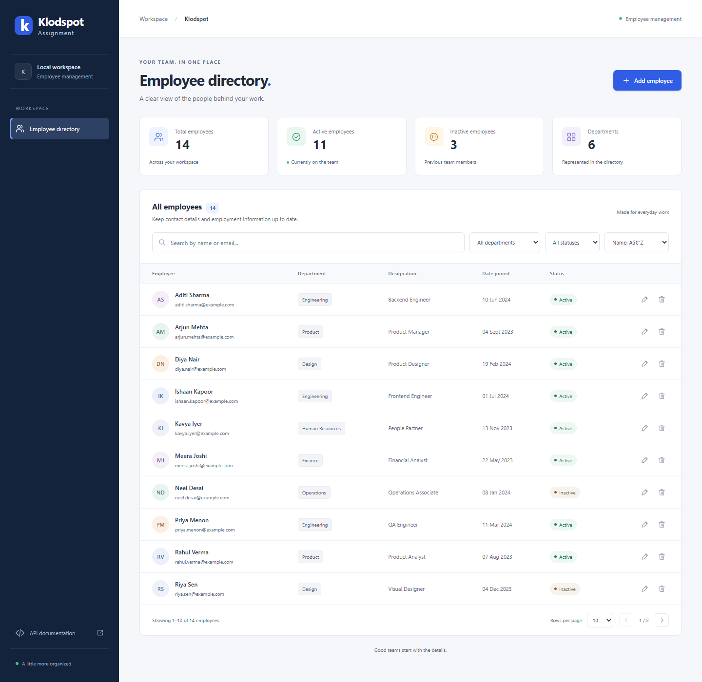

# Klodspot Assignment

An employee directory built with Java 17, Spring Boot and PostgreSQL. It supports employee CRUD, search, filters, pagination, registration and private account directories. The frontend is plain HTML, CSS and JavaScript, served by the same Spring Boot app.

[Open the deployed app](https://assignment.srv957712.hstgr.cloud)



## Try it

Use the **Demo editor** or **Demo viewer** button on the sign-in page, or create an account to start with your own empty directory.

| Account | Username | Password | Access |
| --- | --- | --- | --- |
| Demo editor | `demo` | `KlodspotDemo2026!` | Add, edit and delete sample employees |
| Demo viewer | `viewer` | `KlodspotDemo2026!` | Read sample employees |

These are public demo credentials. Each demo account has a separate sample directory. Registered accounts cannot access either demo directory or another user's records. The administrator's credentials are configured privately on the server.

## Run locally

With Docker and Compose running:

```sh
docker compose up --build
```

Open [localhost:8080](http://localhost:8080). The same demo buttons and registration page are available. Local admin credentials are `admin` / `local-admin-password-2026`; change them in `.env` if needed. Docker keeps PostgreSQL data in a named volume. Stopping the app with `docker compose down` preserves that volume.

To run Java and PostgreSQL directly, see [local development](docs/local-development.md). The Maven Wrapper is included, so a separate Maven installation is optional.

## Project structure

```text
src/main/java/com/klodspot/assignment/
  KlodspotAssignmentApplication.java
  account/       Registration, stored accounts and initial demo/admin accounts
  employee/      Controller, service, repository, entity and search filters
    dto/         API request, response and page records
  security/      Login, current account, sessions and CSRF
  config/        OpenAPI, response headers and sample employee data
  error/         Shared HTTP error handling
src/main/resources/
  db/migration/  Versioned schema changes
  static/
    index.html, login.html, register.html
    css/         Styles
    js/          Page behavior, form handling, API calls and rendering
src/test/        Service, MVC, PostgreSQL and security tests
tests/           Browser tests and screenshot scripts
deploy/          VPS Compose configuration and operating instructions
docs/            Setup, API examples and verification notes
```

Start with `EmployeeController` to follow an API request. It calls `EmployeeService`, which applies the current account's ownership rules and uses `EmployeeRepository` for persistence. `EmployeeRequest` contains the field validation rules. `ApiExceptionHandler` turns expected failures into consistent responses.

On the frontend, `app.js` handles the directory and navigation. `employee-form.js` owns the add/edit dialog, `employee-api.js` handles HTTP requests, and `employee-view.js` renders rows and details. Authentication screens share the session helpers in `session.js`.

## Important choices

- Employee emails are unique within an account's directory. The API and database both enforce this.
- Salary means annual gross pay in INR and uses `BigDecimal` / `NUMERIC(12,2)`.
- Department values are a fixed enum; joining dates cannot be in the future.
- Requests cannot choose their account ID or role. Ownership comes from the signed-in session.
- Passwords are hashed. Hosted writes require a CSRF token, and sessions use secure HTTP-only cookies.
- Flyway owns schema changes; Hibernate only validates the schema.

The open native development profile is intended for local API testing. The hosted `cloud` profile requires login. Email verification, password recovery and account administration screens are outside this assessment.

## Tests and API

```powershell
.\mvnw.cmd test
.\mvnw.cmd verify -Pintegration
```

The second command needs a dedicated `employees_test` database. See [testing](docs/testing.md) for database settings, browser tests and formatting commands, and [verification notes](docs/verification.md) for the checks actually run.

After signing in, open [Swagger UI](https://assignment.srv957712.hstgr.cloud/swagger-ui.html). The [API guide](docs/api.md), [HTTP examples](docs/api.http) and [Postman collection](docs/klodspot-assignment.postman_collection.json) document the endpoints and validation rules.

[VPS deployment instructions](deploy/README.md) cover HTTPS, credentials, backups and updates.
